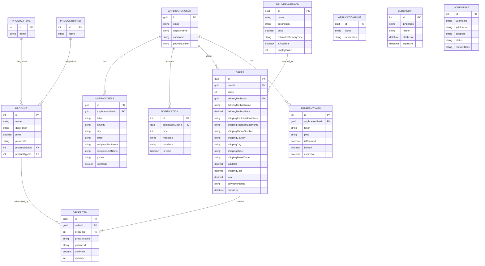
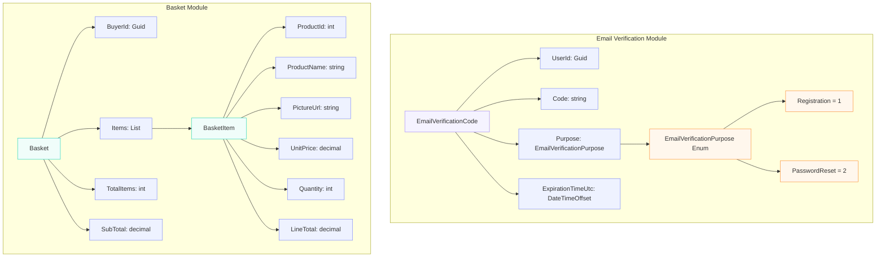
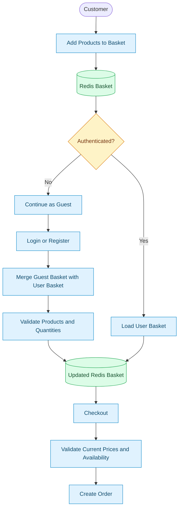

# ECommerce Backend APIs

A practical e-commerce backend built with **.NET 9, ASP.NET Core, Entity Framework Core, SQL Server, and Redis**. The project focuses on more than making endpoints work: it explores clean architectural boundaries, maintainable business rules, caching, security, payment workflows, consistent API responses, and operational visibility.

The API is deployed on MonsterASP, the SQL Server database is hosted on MonsterASP, and Redis is hosted on Upstash.

> **Screenshots:** Each image slot below points to a suggested file under `docs/images/`. Add your screenshots using those filenames, or update the Markdown paths to match your own files. Until the files exist in the repository, GitHub will show broken-image placeholders.

## Contents

- [Overview](#overview)
- [Tech Stack](#tech-stack)
- [Architecture and Dependency Rules](#architecture-and-dependency-rules)
- [Domain Models and Rich Domain Model](#domain-models-and-rich-domain-model)
- [CQRS, MediatR, and FluentValidation](#cqrs-mediatr-and-fluentvalidation)
- [Specification, Builder, and Evaluator](#specification-builder-and-evaluator)
- [Repositories and Unit of Work](#repositories-and-unit-of-work)
- [Database Design and EF Core](#database-design-and-ef-core)
- [API Response Structure](#api-response-structure)
- [Result Pattern and Problem Details](#result-pattern-and-problem-details)
- [Minimal APIs, API Versioning, and Filters](#minimal-apis-api-versioning-and-filters)
- [Authentication and Authorization](#authentication-and-authorization)
- [Basket Module](#basket-module)
- [Caching Strategy](#caching-strategy)
- [Orders and Stripe Payments](#orders-and-stripe-payments)
- [Notifications and SignalR](#notifications-and-signalr)
- [Email and Verification Codes](#email-and-verification-codes)
- [Cloudinary Integration](#cloudinary-integration)
- [IP Security and Rate Limiting](#ip-security-and-rate-limiting)
- [Configuration Encryption and Decryption](#configuration-encryption-and-decryption)
- [Logging with Serilog](#logging-with-serilog)
- [Options and Configuration Validation](#options-and-configuration-validation)
- [CORS](#cors)
- [Seeding](#seeding)
- [Cancellation Tokens](#cancellation-tokens)
- [Architecture Tests](#architecture-tests)
- [Features Summary](#features-summary)
- [Deployment](#deployment)
- [Screenshots Checklist](#screenshots-checklist)
- [Getting Started](#getting-started)
- [Links](#links)

## Overview

This project is an e-commerce API built around explicit responsibilities and reusable application patterns. Instead of putting business workflows directly into endpoint definitions, the application separates HTTP handling, use cases, domain rules, and infrastructure integrations.

The system includes product catalog features, guest and authenticated baskets, authentication flows, user addresses, order management, Stripe payment processing, real-time notifications, email verification, structured logging, and security-related middleware.

## Tech Stack

| Area | Technologies |
|---|---|
| Framework | .NET 9, ASP.NET Core |
| API endpoints | Minimal APIs and a small number of controllers |
| Persistence | SQL Server, Entity Framework Core |
| Caching | Redis, HybridCache, in-memory cache, Output Caching |
| Architecture | Clean Architecture principles, Vertical Slice organization, CQRS |
| Application pipeline | MediatR, FluentValidation |
| Data access | Read Repository, Write Repository, Unit of Work |
| Query composition | Custom Specification Pattern, Builder Pattern, Specification Evaluator |
| Authentication | ASP.NET Core Identity, JWT, refresh tokens |
| Security | ASP.NET Core rate-limiting, Ip Security Middlewares, Decrypted Configuration Provider 
| Integrations | Stripe, Cloudinary, email services |
| Real-time messaging | SignalR |
| Logging | Serilog, SQL Server log storage, Serilog UI dashboard |
| Mapping | Mapster configuration is present; Mapster is not currently used for active mapping |
| Testing | xUnit-based architecture tests |

## Architecture and Dependency Rules

The solution separates responsibilities into projects for the domain, use cases, infrastructure, and API. The exact folder layout can evolve, but the dependency direction is the important part.

- **Domain:** entities, domain errors, shared domain abstractions, and paged-result models.
- **Use Cases:** commands, queries, handlers, DTOs, validators, and abstractions for services implemented by infrastructure.
- **Infrastructure:** database access, repositories, caching, email, payments, file storage in cloudinary, identity integrations, and other external services.
- **API:** HTTP endpoints, API versioning, filters, middleware, authentication configuration, and response formatting.
- **Architecture Tests:** automated checks that help enforce dependency boundaries and violation of clean architecture's rules.

The Use Cases layer defines abstractions for services such as payment processing, notifications, JWT generation, current-user access, IP security, email sending, mail-message building, refresh tokens, and attachments. Infrastructure provides their implementations. This keeps use cases from depending directly on implementation details.

**Architecture diagram**


**Domain dependency boundaries**

The domain project should not depend on Use Cases, Infrastructure, or API. Keeping this boundary clean allows core business rules to remain independent from web frameworks, databases, and external services.


## Domain Models and Rich Domain Model

The domain layer contains the entities and errors that represent the business. Where appropriate, entities expose behavior and enforce rules instead of serving only as property containers.

The project uses a **Rich Domain Model** approach for behavior that belongs with an entity. For example, a model can validate whether a requested state transition is allowed instead of leaving every rule to be repeated across handlers.

Domain models are designed around business concepts and application actions, while infrastructure-specific work remains outside the domain.

**Rich Domain Model code screenshot**


## CQRS, MediatR, and FluentValidation

**CQRS (Command Query Responsibility Segregation)** separates requests that change state from requests that read data:

- A **Command** represents an operation that changes state, such as creating an order or updating an address.
- A **Query** retrieves information without intending to change state, such as getting a user's orders.
- A **Handler** contains the application workflow for a specific command or query.

**MediatR** dispatches commands and queries to their handlers. This keeps endpoint definitions focused on HTTP concerns and makes application use cases easier to locate, reason about, and test.

**FluentValidation** keeps request validation rules in dedicated validators. Where configured in the request pipeline, validation can run before the handler performs the use case.

A typical flow is:

`Minimal API endpoint → MediatR → validation → command/query handler → domain/services/repositories`


## Specification, Builder, and Evaluator

The **Specification Pattern** packages query criteria and related query behavior into reusable objects. Depending on the specification definition, this can include filtering, ordering, paging, includes, or other query instructions.

The project implements its own specification approach rather than relying entirely on a third-party specification library. A custom **Builder Pattern** makes it easier to compose specifications through a readable, fluent API. The **Specification Evaluator** then applies a specification's configured rules to an `IQueryable`, allowing EF Core to translate the resulting query.

This keeps complex query composition out of endpoint handlers and encourages reusable, testable query definitions.


## Repositories and Unit of Work

The data-access layer separates reading from writing:

- **Read Repository:** focuses on retrieval and query-oriented operations.
- **Write Repository:** focuses on operations that modify entities.
- **Unit of Work:** coordinates repository access and the persistence boundary for a set of changes.

The solution also contains purpose-specific abstractions where needed, such as basket and email-code storage interfaces. These interfaces let application workflows depend on the operation they need instead of a concrete persistence implementation.


## Database Design and EF Core

The project uses **SQL Server and Entity Framework Core**. Separate DbContexts are used for application/domain entities and Identity entities, helping separate their persistence responsibilities.

### Database design and indexes

Database structure is designed around the application's main areas, including products, identity, user addresses, orders, notifications, and security records. Some short-lived data, such as baskets and verification codes, is stored in Redis according to its lifecycle.

Indexes are used to support relevant lookup, filtering, and relationship queries. Index choices should follow actual query patterns and be reviewed with generated SQL and execution plans; indexes improve suitable queries but also add write and storage overhead.

# 1) SQl Server Schema


# 2) Redis


### EF Core interceptors, global query filters, and soft delete

- **EF Core interceptors** centralize selected persistence behavior instead of repeating it throughout repositories.
- **Global query filters** automatically apply common rules to queries, such as excluding soft-deleted entities from normal results.
- **Soft delete** is used where appropriate so records can be marked as deleted rather than physically removed immediately.

Soft deletion is applied according to the entity's business and retention requirements, rather than assuming every entity must use the same deletion behavior.

### Data seeding

The project has a seeding module for initializing required data. Keeping seeding logic organized separately makes it easier to maintain and extend as new entities or default records are introduced.

## API Response Structure

The API uses a unified response shape for successful responses and relevant metadata. The response structure includes:

- `Success`: indicates whether the operation succeeded.
- `Message`: an optional human-readable message.
- `Data`: the response payload.
- `Meta`: metadata associated with the response.
- `Meta.TraceId`: helps correlate an API response with server-side logs.
- `Meta.Pagination`: provides pagination details for paged results.

The pagination metadata includes `PageNumber`, `PageSize`, `TotalCount`, `TotalPages`, `HasPreviousPage`, and `HasNextPage`. This gives API clients enough information to render pagination controls without recalculating the paging state themselves.

Example shape:

```json
{
  "success": true,
  "message": "Products retrieved successfully.",
  "data": [],
  "meta": {
    "traceId": "example-trace-id",
    "pagination": {
      "pageNumber": 1,
      "pageSize": 10,
      "totalCount": 0,
      "totalPages": 0,
      "hasPreviousPage": false,
      "hasNextPage": false
    }
  }
}
```

The example illustrates the intended shape; actual messages and payloads depend on the endpoint. For consistency, the API should ensure that `Meta` and `TraceId` are populated by the response-building path, including when handling errors.


## Result Pattern and Problem Details

The **Result Pattern** represents expected success or failure explicitly. A use case can return a result containing a domain/application error instead of using exceptions for every expected business outcome.

The API maps error categories to HTTP status codes in a centralized response factory. The mapping includes validation errors (`400`), unauthorized (`401`), forbidden (`403`), not found (`404`), conflicts (`409`), and unexpected failures (`500`).

A global exception handler handles unexpected exceptions, while **Problem Details** provides a standardized structure for error responses. The response can include a trace ID so the client or developer can correlate the failure with logs.

This separates expected business failures from unexpected application errors and gives clients a more predictable API contract.


## Minimal APIs, API Versioning, and Filters

### Minimal APIs

Most endpoints use **ASP.NET Core Minimal APIs**, with a small number of controllers where appropriate. Endpoint definitions stay lightweight, while MediatR handlers and services own the use-case behavior.

### API versioning

API versioning makes the supported API contract explicit and provides a path for evolving endpoints without silently changing what existing clients rely on.


### Endpoint and action audit filters

Audit filters are used to capture relevant endpoint/action execution information for troubleshooting and operational visibility. Logging should focus on useful metadata and must avoid recording passwords, tokens, verification codes, or other sensitive values.

### Buyer ID attribute filter

A dedicated attribute filter handles repeated buyer-ID logic in one place. This avoids duplicating the same extraction or validation logic across every endpoint that needs a buyer identifier.

### Serilog UI authorization filter

An authorization filter protects the Serilog UI dashboard so access is checked before users can view operational logs. The dashboard should remain restricted in production and should not be exposed publicly without appropriate access controls.

## Authentication and Authorization

Authentication uses **ASP.NET Core Identity and JWT bearer tokens**. Identity-related work is accessed through application abstractions where appropriate, keeping the use-case layer decoupled from direct `UserManager` or `RoleManager` usage.

The authentication workflows include:

- Registration and email verification.
- Login and JWT authentication.
- Refresh-token handling.
- Change-password functionality.
- Logout.
- Role-based authorization where configured.

Logout should revoke or invalidate the relevant refresh-token state. A JWT access token that has already been issued usually remains valid until expiration unless the application implements an additional access-token revocation mechanism.

## Basket Module

The basket module supports **guest users as well as authenticated users**. A customer can add items before creating an account or logging in, with basket state stored in Redis.

After login or registration, the guest basket can be merged with the user's basket according to the application's merge rules. This avoids forcing account creation before shopping and provides a smoother transition from guest to authenticated usage.

Redis is a suitable fit for this kind of data because basket state is frequently accessed and can have a configurable lifetime. The basket workflow still needs to validate product availability, quantities, and prices against trusted server-side data when creating an order.




## Caching Strategy

The project uses multiple caching mechanisms according to the type and lifetime of the data:

- **Redis:** distributed storage for basket data and verification codes.
- **Output Caching:** caches eligible HTTP responses, including product responses where configured.
- **HybridCache:** provides a unified caching approach for selected application data.
- **In-memory caching:** supports suitable local cache scenarios.
- **Aggregate cache service:** centralizes cache operations for selected data groups.
- **Cache-entry policies:** define expiration behavior, including time-to-live (TTL), and applicable absolute or sliding expiration.

### Basket and verification-code caching

Basket state and verification codes are stored in Redis with dedicated entry policies. Verification codes should expire automatically and be checked for the correct user and purpose before they are accepted.

### Product Output Caching

Output Caching reduces repeated processing for eligible product responses. Cache invalidation and expiration need to account for product updates so clients do not continue receiving stale product data beyond the intended policy.

### Options and `IOptionsMonitor`

Cache policies and TTL settings are held in typed options rather than spread across unrelated services. `IOptionsMonitor<T>` allows consumers to read current option values and supports change notifications in supported configuration providers.

The exact lifetime and expiration policy should be selected based on how quickly the data changes and how stale a response is allowed to be.

## Orders and Stripe Payments

### Order features

The order workflows include creating orders, retrieving a user's orders, retrieving an order by ID, cancelling orders when allowed, and initiating payment. Ownership and valid state transitions should be checked before allowing sensitive operations.

### Stripe integration

Stripe is integrated through Payment Intents and webhook handling. The backend uses payment-provider events to update the relevant application state rather than trusting only a client-side success message.

Idempotency helps prevent duplicate processing of payment-related operations. Webhook handlers should also tolerate duplicate event delivery, since payment providers can retry events.

Notifications are sent for relevant order-creation and payment events.

## Notifications and SignalR

The notification module combines **database persistence with real-time delivery through SignalR**, allowing users to receive updates instantly while keeping their notification history available for later.

### Notification Design

Each notification contains the following properties:

- **`ApplicationUserId`**: Identifies the user who receives the notification.
- **`Type`**: Defines the notification category, allowing the client to handle different notification types appropriately.
- **`Message`**: Contains the notification text displayed to the user.
- **`DataJson`**: An optional JSON payload containing contextual data related to the notification.
- **`IsRead`**: Tracks whether the user has read the notification.

### Contextual Data with `DataJson`

Instead of limiting notifications to plain text, I added `DataJson` to carry additional information about the related business entity.

For example, an order notification can include an `OrderId`, while a user-related notification can include a `UserId`. The frontend can deserialize this payload and use the provided identifier to navigate directly to the relevant order details or user profile.

This keeps the notification model flexible without requiring additional database columns for every possible notification context.

**Example payload for an order notification:**

```json
{
  "orderId": 125,
  "action": "view-order"
}
```

The frontend can use `orderId` to navigate to the corresponding order details page when the user clicks the notification.

### Real-Time Delivery

SignalR delivers notifications to connected clients as relevant business events occur, such as order creation or payment updates. Notifications are also persisted in the database, so users can retrieve them later, even if they were offline when the event occurred.

The module supports retrieving notifications, tracking unread notifications, marking individual or all notifications as read, and deleting notifications where implemented.

By combining persistent storage, contextual payloads, and real-time delivery, the module provides a flexible notification mechanism that can be extended to support additional business events without redesigning the notification entity.

## Email and Verification Codes

Email sending and email-message construction are separated into dedicated responsibilities:

- **Mail/message builder service:** prepares the message content, subject, HTML template, and supported attachments.
- **Email/mail sending service:** sends the prepared message through the configured email transport.
- **HTML templates:** provide consistent, branded email layouts, including a logo.
- **Redis verification-code storage:** stores codes with an expiration policy for the verification workflow.

Separating message construction from message delivery makes templates easier to reuse and keeps SMTP/provider-specific code out of application workflows.

Never include real verification codes or credentials in screenshots or logs.


## Cloudinary Integration

Cloudinary is integrated through a dedicated attachment/file service. This separates media storage from the main relational database and allows the application to store an asset reference or URL with the related business data.

The upload workflow should validate file size and type, apply appropriate access rules, and avoid trusting client-provided file metadata without validation.


## IP Security and Rate Limiting

### Rate limiting

ASP.NET Core rate-limiting middleware limits request traffic according to the configured policy and partition key. When a client exceeds the configured limit, the API can return a controlled response instead of allowing unbounded request volume.

### IP security middleware

Custom IP security middleware checks requests against the application's configured rules and stored security records. The security schema includes:

- `Security.LoginAudits`: records relevant login-attempt information.
- `Security.BlockedIps`: stores IP addresses that have been blocked.
- Checks intended to identify suspicious request payload patterns.
- Brute-force protection based on repeated failed login attempts, according to the configured rules.

These checks provide an additional layer of defense. Pattern-based payload inspection does not replace parameterized SQL queries, proper input validation, output encoding, authentication, authorization, or other framework security practices.

## Configuration Encryption and Decryption

The project includes a configuration provider designed to decrypt protected configuration values when the application loads configuration.

At a high level, the flow is:

1. Sensitive values are stored in encrypted form rather than as readable plaintext.
2. The application obtains the encryption key from a separate trusted source, such as an environment variable or deployment secret.
3. The custom provider decrypts the protected values during configuration loading.
4. Services read the resulting values through the standard .NET configuration and options abstractions.

**Encryption and hashing are different.** Encryption is reversible when the correct key is available. Hashing is one-way and is not suitable when the original value—such as a connection string or API key—must be recovered at runtime. If a value must be read again, use an appropriate encryption/decryption design rather than describing it as hashing.

The key must not be stored beside the encrypted values or committed to source control. For production, use a trusted secret store or hosting-platform secret settings when available. Never show real secrets or keys in README screenshots.

## Logging with Serilog

Serilog provides structured application logging, with log records stored in SQL Server. Structured logs make it easier to search for events and investigate application behavior.

The Serilog UI dashboard provides a user interface for viewing and querying stored logs. Access is protected through the configured authorization filter. The dashboard should be restricted to trusted users, especially in production, because log records can expose internal operational details.

Logs must not contain passwords, access or refresh tokens, verification codes, encryption keys, or other secrets.


```
  "Serilog": {
    "Using": [ "Serilog.Sinks.Console", "Serilog.Sinks.MSSqlServer" ],
    "MinimumLevel": {
      "Default": "Information",
      "Override": {
        "Microsoft": "Warning",
        "System": "Warning",
        "Microsoft.AspNetCore": "Warning",
        "Microsoft.EntityFrameworkCore": "Warning",
        "Microsoft.EntityFrameworkCore.Database.Command": "Error"
      }
    },
    "WriteTo": [
      { "Name": "Console" },
      {
        "Name": "MSSqlServer",
        "Args": {
          "connectionString": "Server=db72658.public.databaseasp.net; Database=db72658; User Id=db72658; Password=Muhvmd_44; Encrypt=True;",
          "tableName": "Logs",
          "schemaName": "Logging",
          "autoCreateSqlTable": true
        }
      }
    ],
    "Enrich": [
      "FromLogContext",
      "WithMachineName",
      "WithThreadId"
    ]
  }
```

## Options and Configuration Validation

Related settings are grouped into typed options classes. This gives configuration a clear structure and avoids scattering raw configuration keys throughout the application.

The project uses FluentValidation validators for supported options/settings through `IValidator<T>`. Validating configuration early helps detect missing or invalid values during startup instead of discovering them only when a feature is used.

The same options approach is used for settings such as cache TTL and cache-entry policies. `IOptionsMonitor<T>` is useful when consumers need access to current values or supported configuration-change notifications.

# - Configurations Example


# - Validator Example


## CORS

CORS is configured through an explicit policy that lists allowed origins, headers, methods, and credential behavior. The configured origins must match the actual frontend environments.

When `AllowCredentials()` is enabled, do not use a wildcard origin. Keep the allowed-origin list narrow, and configure production frontend origins deliberately instead of leaving development origins as the only allowed values.

## Seeding

The seeding mechanism is designed around the **Open/Closed Principle (OCP)**. Each seeder handles a specific entity, while the `DatabaseSeeder` orchestrates execution without depending on concrete seeder implementations.

### Example: Adding a New Seeder

**1. Implement `IDataSeeder`**

For example, a `BrandSeeder` loads brand data from a JSON file and maps each model to a domain entity.

```csharp
public class BrandSeeder(ApplicationDbContext context)
    : IDataSeeder
{
    public int Order => 1;

    public async Task SeedDataAsync(
        CancellationToken ct = default)
        => await JsonSeeder.SeedIfEmpty<
            ProductBrand, int, ProductBrandSeedModel>(
                context.Set<ProductBrand>(),
                "brands.json",
                model => ProductBrand.Create(model.Name),
                ct
            );
}
```

**2. Reuse the Generic `JsonSeeder`**

The `JsonSeeder` handles the common logic:

- Reads seed data from JSON files.
- Skips seeding when the target table already contains data.
- Deserializes JSON into seed models.
- Supports both synchronous mapping and asynchronous mapping for operations such as image uploads.
- Respects `CancellationToken` throughout asynchronous operations.

This keeps data-loading logic separate from entity-specific mapping.

**3. Register the Seeder**

Register the new seeder in the dependency injection container:

```csharp
services.AddScoped<IDataSeeder, BrandSeeder>();
```

The `DatabaseSeeder` automatically discovers registered seeders through `IEnumerable<IDataSeeder>`, orders them by their `Order` property, executes them, and saves the changes.

```csharp
public async Task SeedAsync(
    CancellationToken ct = default)
{
    foreach (var seeder in seeders.OrderBy(s => s.Order))
    {
        await seeder.SeedDataAsync(ct);
        await context.SaveChangesAsync(ct);
    }
}
```

### Why This Design?

Adding a new seeder, such as `ProductTypeSeeder`, `ProductSeeder`, or `DeliveryMethodSeeder`, requires implementing `IDataSeeder` and registering the implementation. The existing orchestration logic does not need to change.

This keeps the seeding mechanism **extensible, reusable, and maintainable**, while allowing execution order to be controlled explicitly when seeders depend on previously seeded data.

## Cancellation Tokens

Asynchronous operations accept and propagate `CancellationToken` where applicable. ASP.NET Core exposes a request-aborted token that can be passed through endpoints, MediatR handlers, services, and asynchronous EF Core operations.

Cancellation tokens let work stop when a client disconnects or a request is cancelled, helping avoid unnecessary database and application work. Cancellation is cooperative: an operation can stop only when the underlying API supports and observes the token, and some external operations may have their own cancellation limitations.

## Architecture Tests

The solution includes a separate **`ECommerce.ArchitectureTests`** project using xUnit and architecture-testing assertions to verify dependency rules.

For example, the domain assembly is checked to ensure it does not depend on the Use Cases, Infrastructure, or API projects:

```csharp
private static readonly Assembly DomainAssembly =
    typeof(BaseEntity).Assembly;

[Fact]
public void Domain_Should_Not_Depend_On_Any_Other_Project()
{
    var result = Types.InAssembly(DomainAssembly)
        .ShouldNot()
        .HaveDependencyOnAny(
            "ECommerce.UseCases",
            "ECommerce.Infrastructure",
            "ECommerce.API")
        .GetResult();

    result.IsSuccessful.ShouldBeTrue(FormatFailingTypes(result));
}
```

This type of test makes architectural decisions executable. If a future change introduces a forbidden dependency, the test can fail and highlight the types that violate the boundary.

Architecture tests are currently in place, and unit-test coverage for individual use cases and business rules can continue to expand.

## Features Summary

### Product catalog
- Product, brand, and type operations.
- Pagination and specification-driven query composition.
- Indexes and Output Caching for suitable product queries/responses.

### Basket
- Redis-backed basket storage.
- Guest shopping without login.
- Basket merging after login or registration.

### Authentication and users
- Identity and JWT authentication.
- Registration, verification, login, refresh-token handling, change password, and logout.
- User profile and address management.
- Default address support through an `IsDefault` flag.

### Orders and payments
- Create and retrieve orders.
- Cancel orders when the current state permits it.
- Stripe Payment Intents and webhooks.
- Idempotency safeguards for payment workflows.
- Notifications for order creation and payment events.

### Notifications and operations
- Persisted notifications and SignalR delivery.
- Serilog structured logging and UI dashboard.
- Rate limiting, IP security, login auditing, and blocked-IP records.
- Cloudinary media storage and HTML email templates.
- Encrypted configuration values loaded through a custom provider.

# .NET 9 E-Commerce – Stripe Payment Intents

```mermaid
%%{init: {'theme':'base','themeVariables':{'darkMode':true,'background':'#1b1c22','primaryColor':'#2a2b33','primaryTextColor':'#e6e6e6','primaryBorderColor':'#9a9a9a','lineColor':'#d0d0d0','actorBkg':'#2a2b33','actorBorder':'#9a9a9a','actorTextColor':'#e6e6e6','actorLineColor':'#8a8a8a','signalColor':'#e6e6e6','signalTextColor':'#e6e6e6','labelBoxBkgColor':'#2a2b33','labelBoxBorderColor':'#9a9a9a','labelTextColor':'#e6e6e6','loopTextColor':'#e6e6e6','noteBkgColor':'#3d3e45','noteTextColor':'#e6e6e6','noteBorderColor':'#777','activationBkgColor':'#3a3b42','activationBorderColor':'#aaa','sequenceNumberColor':'#111111'}}}%%
sequenceDiagram
    autonumber
    participant C as Client / Browser
    participant API as Orders and Payments API (L1)
    participant UC as Application Use Cases (L3)
    participant PS as IPaymentService / StripePaymentService (L4)
    participant DB as Database (L5)
    participant R as Basket Store (Redis)
    participant S as Stripe API (L6)

    rect rgb(66,68,72)
    Note over C,S: A) Create Order
    end
    C->>API: POST /api/v1/orders {shippingAddressId, deliveryMethodId}
    activate API
    API->>UC: CreateOrderCommand
    activate UC
    UC->>DB: Load ShippingAddress and DeliveryMethod
    DB-->>UC: address, deliveryMethod
    UC->>R: Get customer basket
    R-->>UC: basket items
    Note over UC: Validate data and calculate order total on server
    UC->>DB: Persist Order (Status = Pending)
    DB-->>UC: orderId
    UC->>R: Clear customer basket
    R-->>UC: cleared
    UC-->>API: orderId, Pending
    deactivate UC
    API-->>C: 201 Created {orderId, status: "Pending"}
    deactivate API

    rect rgb(66,68,72)
    Note over C,S: B) Create Stripe PaymentIntent
    end
    C->>API: POST /api/v1/orders/{orderId}/pay (Authorization: Bearer JWT)
    activate API
    API->>UC: CreateOrderPaymentCommand
    activate UC
    UC->>DB: Load Order by orderId
    DB-->>UC: Order or null
    alt Order not found
        UC-->>API: NotFound
        API-->>C: 404 Not Found
    else Not owned by user or Status is not Pending
        UC-->>API: Validation / ownership error
        API-->>C: Error response (e.g. 403 Forbidden / 400 Bad Request)
    else Valid order (owner and Status = Pending)
        UC->>PS: CreatePaymentIntentAsync(amount, currency, orderId)
        activate PS
        PS->>S: PaymentIntents.Create (Idempotency-Key: payment_intent_order_{orderId})
        S-->>PS: pi_xxx, clientSecret
        PS->>PS: UpdatePaymentIntentAsync(pi_xxx, amount, orderId)
        PS->>S: PaymentIntents.Update(amount)
        S-->>PS: Updated PaymentIntent
        PS-->>UC: PaymentIntentResult
        deactivate PS
        UC->>DB: Attach PaymentIntentId to Order and SaveChanges
        DB-->>UC: saved
        UC-->>API: clientSecret, paymentIntentId
        API-->>C: 200 OK {clientSecret, publishableKey, paymentIntentId}
    end
    deactivate UC
    deactivate API

    rect rgb(66,68,72)
    Note over C,S: C) Card entry - browser talks to Stripe only (not via backend)
    end
    Note over C: Init Stripe.js with publishableKey
    C->>S: stripe.confirmCardPayment(clientSecret) (Stripe.js + Elements)
    alt Authentication required (3D Secure)
        S-->>C: requires_action (challenge)
        C->>S: Complete authentication
    else No additional authentication required
        Note over S: Stripe proceeds with payment confirmation
    end
    S-->>C: Payment result (success / failure / non-final state)
    Note over C,API: Browser-side result is NOT the source of truth. The backend must rely on the verified Stripe webhook.

    rect rgb(66,68,72)
    Note over C,S: D) Webhook - source of truth (async, seconds later)
    end
    S->>API: POST /api/v1/payments/webhook (raw body, Stripe-Signature header)
    activate API
    API->>UC: HandleStripeWebhookCommand(json, signature)
    activate UC
    UC->>UC: Verify signature (EventUtility.ConstructEvent with webhook secret)
    alt Invalid signature or invalid webhook
        UC-->>API: InvalidWebhook (no order or payment change)
        API-->>S: 400 Bad Request
    else Valid signature
        alt payment_intent.succeeded
            UC->>DB: Find Order / Payment by PaymentIntentId
            DB-->>UC: Order
            opt Event already processed (duplicate)
                Note over UC: Skip business operation (idempotent)
                UC-->>API: Success
                API-->>S: 200 OK
            end
            UC->>UC: Order.MarkAsPaid() - Status = Processing, PaidUtc = now
            UC->>DB: Persist changes and mark event as processed
            DB-->>UC: saved
            UC-->>API: Success
            API-->>S: 200 OK
        else payment_intent.payment_failed
            UC->>UC: Record / log payment failure (Order stays Pending)
            UC-->>API: Handled
            API-->>S: 200 OK
        else Other event types
            Note over UC: Ignore unsupported event safely
            UC-->>API: Ignored
            API-->>S: 200 OK
        end
    end
    deactivate UC
    deactivate API
    Note over API,DB: Webhook processing is the authoritative mechanism for updating payment and order status. Order: Pending (initial) becomes Processing with PaidUtc set.
```



## Deployment

- **API:** MonsterASP
- **SQL Server database:** MonsterASP
- **Redis:** Upstash

Keep deployment secrets in environment variables or the hosting platform's secret configuration. Do not commit real connection strings, JWT signing keys, Stripe secrets, Cloudinary credentials, SMTP passwords, or encryption keys.

## Screenshots Checklist

Create `docs/images/` in the repository and add screenshots using these suggested filenames.

| Section | Suggested filename |
|---|---|
| Overall architecture | `architecture-diagram.png` |
| Domain dependencies | `domain-dependency-boundaries.png` |
| Rich Domain Model | `rich-domain-model.png` |
| CQRS and MediatR | `cqrs-mediatr-diagram.png` |
| Specification, Builder, Evaluator | `specification-builder-evaluator.png` |
| Read/Write Repositories | `read-write-repositories.png` |
| Database ERD | `database-design.png` |
| Database indexes | `database-indexes.png` |
| EF Core interceptors, filters, seeding | `efcore-interceptors-filters-seeding.png` |
| API response structure | `api-response-structure.png` |
| Result and Problem Details | `result-problem-details.png` |
| API versioning / Swagger | `api-versioning-swagger.png` |
| Authentication flow | `authentication-flow.png` |
| Guest basket and merge | `basket-guest-merge.png` |
| Caching strategy | `caching-strategy.png` |
| Order and payment flow | `order-payment-flow.png` |
| SignalR notifications | `signalr-notifications.png` |
| Email template and logo | `email-template-logo.png` |
| Email message builder / attachments | `email-message-builder-attachments.png` |
| Verification code in Redis | `verification-code-redis.png` |
| Cloudinary | `cloudinary-integration.png` |
| IP security middleware | `ip-security-middleware.png` |
| LoginAudits and BlockedIps | `security-schema-login-audits-blocked-ips.png` |
| Configuration encryption provider | `configuration-encryption-provider.png` |
| Serilog UI | `serilog-ui-dashboard.png` |
| Serilog SQL Server storage | `serilog-sqlserver-logging.png` |
| CORS | `cors-configuration.png` |
| Seeding | `seeding-module.png` |
| Architecture tests | `architecture-tests-xunit.png` |

Use redacted screenshots. Do not expose tokens, verification codes, credentials, customer data, private URLs, or production secrets.

## Getting Started

### Prerequisites

- .NET 9 SDK
- SQL Server
- Redis, locally or hosted
- Stripe credentials for payment workflows
- Cloudinary credentials for file uploads
- Email provider credentials for sending messages

### Setup

1. Clone the repository:

   ```bash
   git clone https://github.com/Muhvmd8/ECommerceCore.git
   cd ECommerceCore
   ```

2. Configure the required database, Redis, JWT, email, Stripe, Cloudinary, and configuration-encryption settings using a secure local configuration source or environment variables. Do not commit real secrets.

3. Restore and build:

   ```bash
   dotnet restore
   dotnet build
   ```

4. Apply EF Core migrations using the migration and startup projects in your solution. Adapt the project names to the actual solution:

   ```bash
   dotnet ef database update --project <InfrastructureProject> --startup-project <ApiProject>
   ```

5. Run the API project:

   ```bash
   dotnet run --project <ApiProject>
   ```

6. Open the Swagger URL shown by the application, or use the deployed documentation link below.

> The exact project paths, configuration keys, and migration command depend on the current solution structure. Check the repository before running the example commands unchanged.

## Links

- **GitHub repository:** https://github.com/Muhvmd8/ECommerceCore
- **Deployed Swagger:** https://ecommercecore.runasp.net/swagger/index.html

---

This project is an ongoing backend engineering effort focused on building a system that is not only functional, but also structured, testable, secure, and easier to maintain. The emphasis is on understanding why each pattern or infrastructure component is used and how it contributes to the overall design.
'''

output_path = "/mnt/data/README.md"
pypandoc.convert_text(readme, "md", format="md", outputfile=output_path, extra_args=["--standalone"])
print(f"Created README.md at {output_path} ({len(readme.split())} words).")
